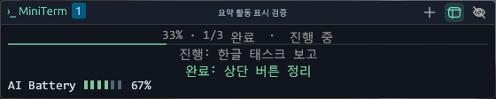
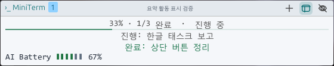
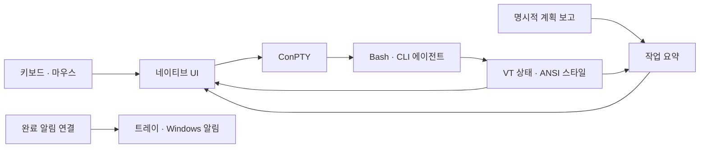

# MiniTerm

Persistent Bash Terminal HUD for Windows

다른 앱에서 작업하는 동안에도 셸과 CLI 에이전트를 계속 실행하는 작은 터미널입니다. 작업표시줄 위에서 명령을 입력하고, 더블 클릭으로 화면을 펼치고, 작업 상태와 알림을 확인합니다.


[](LICENSE)

[Install](#install) · [Features](#features) · [Quick Start](#quick-start) · [Controls](#controls) · [Task Summary](#task-summary) · [Known Issues](#known-issues) · [Development](#development)

> **테스터용 알파입니다.** 기본 Git Bash에서 리사이즈 직후 첫 글자가 누락되는 문제가 남아 있습니다. 수정 런타임의 격리 검사는 통과했지만 이번 배포에는 포함하지 않습니다. 중요한 작업에 사용하기 전에 [알려진 문제](#known-issues)를 확인하세요.

## Overview

MiniTerm은 지속되는 Bash 세션을 작은 데스크톱 창으로 제공합니다. 창을 숨기거나 다른 앱으로 이동해도 명령과 에이전트가 계속 실행됩니다. 입력 화면과 요약 화면을 선택하고, 필요한 순간에 같은 창을 위로 펼칠 수 있습니다.

Rust 네이티브 UI와 DX12 렌더링, ConPTY를 사용합니다. 앱 실행에 WebView2나 Node.js가 필요하지 않습니다. Codex·Claude Code·AI Battery는 별도로 설치한 도구를 실행합니다.

| Dark | Light |
| --- | --- |
|  |  |

실제 앱에서 고정 테스트 계획과 배터리 값을 표시한 샘플입니다. 진행률은 보고된 작업 항목의 완료 비율이며 실제 계정 사용량이나 모델의 자동 작업 분석을 보여주는 이미지는 아닙니다.

## Features

| Feature | Description |
| --- | --- |
| 지속되는 세션 | 최대 네 개의 Bash 세션, 숨겨도 유지되는 실행 상태 |
| 작은 입력 창 | 최근 출력과 현재 입력 줄을 표시하고 더블 클릭으로 확장 |
| 작업 요약 | 세션 제목, 실행 상태, 명시된 계획의 현재·완료 태스크 |
| 터미널 스타일 | ANSI 색상·볼드·이탤릭, 한글 및 TUI 기호 폴백 |
| GUI 설정 | 테마·글꼴·투명도, 프롬프트 정보·별칭·요약 항목 선택 |
| 알림 연결 | Codex·Claude Code 연결과 트레이 복귀 경로 |
| AI Battery 표시 | 별도로 설정한 CLI의 사용량 행을 입력·요약 화면에 표시 |

## Platform Support

| Environment | Status | Requirement |
| --- | --- | --- |
| Windows 11 x64 + Git Bash | 기본 테스트 대상 | Git for Windows, DX12 지원 드라이버 |
| WSL2 Bash | 선택 프로필·검증 진행 중 | 설치된 WSL2 배포판; 현재 개발 장치에서 서비스 오류가 남음 |
| Windows ARM64 / Windows 10 | 지원 대상 아님 | x64 설치본 제공 |
| Linux / macOS | 제공하지 않음 | Windows 전용 앱 |

## Install

[GitHub Releases](https://github.com/hojin-v/MiniTerm/releases)에서 테스터 알파를 선택합니다. 첫 배포 버전은 `v0.1.0-alpha.1`입니다. 태그 빌드가 완료되면 설치본과 ZIP이 등록됩니다.

| Download | Use |
| --- | --- |
| `MiniTerm-0.1.0-alpha.1-windows-x64-setup.exe` | 권장 사용자별 설치. 관리자 권한 불필요 |
| `MiniTerm-0.1.0-alpha.1-windows-x64.zip` | 압축을 풀고 `miniterm.exe` 실행. 설치·알림 등록은 자동 수행하지 않음 |
| `SHA256SUMS` | 다운로드 파일의 무결성 확인 |

Git for Windows와 [Microsoft Visual C++ v14 x64 런타임](https://learn.microsoft.com/en-us/cpp/windows/latest-supported-vc-redist)을 별도로 준비해야 합니다. 실행 파일에서 `VCRUNTIME140.dll` 의존성을 확인했습니다. 설치본은 서명되지 않았으며 Windows에서 게시자를 확인할 수 없다는 안내가 나올 수 있습니다. 백신을 끄거나 경고를 일괄 우회하는 방식은 안내하지 않습니다.

설정은 설치본과 ZIP 모두 `%LOCALAPPDATA%\MiniTerm\settings.json`을 사용합니다. ZIP은 설정까지 독립적인 포터블 모드가 아닙니다. 자세한 설치·업데이트·복구 절차는 [테스터 안내](docs/TESTER_GUIDE.md)를 확인하세요.

## Quick Start

1. Git for Windows와 Microsoft Visual C++ v14 x64 런타임을 준비하고 MiniTerm 설치본 또는 ZIP을 실행합니다.
2. 작은 창을 클릭하고 아래 명령으로 입력과 출력을 확인합니다.

   ```bash
   printf 'Hello, MiniTerm!\n'
   printf '한글 ABC 123\n'
   ```

3. 제목이나 본문을 더블 클릭해 펼치고, 다시 더블 클릭해 접습니다. 가장자리로 크기를 조절하고 헤더를 드래그해 이동합니다.
4. 트레이 메뉴의 `설정`에서 글꼴·테마·프롬프트·알림을 선택합니다. 셸 변경은 새 세션에 적용됩니다.
5. 이미 설치·설정한 CLI 에이전트를 새 세션에서 실행합니다. MiniTerm은 에이전트 설치나 로그인을 대신하지 않습니다.

## Controls

| Action | Control |
| --- | --- |
| 새 세션 / 세션 전환 | 상단 `+` / 세션 번호 |
| 확장 / 축소 | 제목 또는 본문 더블 클릭 |
| 단어 선택 | Shift + 더블 클릭 |
| 입력 / 요약 전환 | 화면 구성 아이콘 |
| 숨기기 / 다시 열기 | 숨기기 아이콘 / 트레이 클릭 |
| 복사 / 붙여넣기 | `Ctrl+Shift+C` / `Ctrl+V` 또는 `Ctrl+Shift+V` |
| 설정 / 종료 | 트레이 메뉴 |
| 열기 단축키 | 기본 `Ctrl+Alt+Space`, 실기 검증 진행 중 |

숨기기는 실행을 유지합니다. 앱 종료나 설치·업데이트 전에 진행 중인 셸 작업을 마치세요. 세션 번호를 오른쪽 클릭하면 해당 세션의 종료 확인을 표시합니다.

## Task Summary

상단에는 세션 제목을, 본문에는 실행 상태와 현재 태스크를 표시합니다. 하단 AI Battery는 터미널에 실제로 출력된 행을 사용합니다. 원시 내부 명령문은 `파일 내용 확인` 같은 짧은 활동명으로 표시합니다.

계획이 보고되면 완료 항목 비율과 진행 중·최근 완료 태스크를 표시합니다. 계획이 없으면 비율을 만들지 않고 실행 상태와 최근 활동을 표시합니다. 긴 작업명과 생략된 목록은 호버 안내 하나로 확인합니다.

이 저장소의 [`miniterm-progress`](.agents/skills/miniterm-progress/SKILL.md) skill은 MiniTerm 안에서 작업하는 에이전트가 짧은 계획을 직접 보고하는 통로입니다. 다른 프로젝트에 자동 설치되지 않으며 모든 CLI의 진행도를 자동 수집하지 않습니다. [데이터와 동작 범위](docs/MINI_SUMMARY.md)를 확인하세요.

## AI Battery & Notifications

[AI Battery](https://github.com/hojin-v/ai-battery)를 별도로 설정한 환경에서는 해당 도구의 사용량 행을 유지합니다. MiniTerm 자체가 사용량을 추정하거나 AI Battery를 함께 설치하지는 않습니다. 설치·설정 방법은 AI Battery의 안내를 따릅니다.

Codex·Claude Code 알림 연결은 설정에서 선택합니다. 새로 시작하는 CLI에 적용되며 기존 설정과 콜백을 보존합니다. 현재 검증은 별도 CLI·로컬 응답·helper·IPC 전달까지이며 실제 Windows 알림 클릭과 실제 계정 응답의 전체 경로는 추가 시험이 필요합니다. [알림 안내](docs/NOTIFICATIONS.md)를 확인하세요.

## Known Issues

| Issue | Current status |
| --- | --- |
| 리사이즈 직후 입력 누락 | 기본 Git Bash의 첫 글자 누락이 재현됨. 격리 MSYS v3 패치는 입력·신호 검사를 통과했으나 배포 미포함 |
| 메모리 목표 | 일부 샘플이 200MB 목표를 초과. 전체 성능 통과로 표시하지 않음 |
| 실제 입력·알림 | 한글 IME 조합·후보창, 실제 단축키와 알림 클릭 검증이 남음 |
| 성능·호환성 | 출력 부하·입력→화면 지연·혼합 DPI·다른 장치·깨끗한 설치 환경 검증이 남음 |
| 에이전트 요약 | 실제 모델의 지속적인 skill 선택·진행 보고는 별도 검증 대상 |

기본 터미널을 대체하는 안정판이 아닌 제한된 테스터 알파입니다. [현재 진단](docs/STATUS.md), [테스트 순서](docs/TESTER_GUIDE.md), [전체 체크리스트](docs/WORK_CHECKLIST.md)를 확인하세요. 문제는 [Issues](https://github.com/hojin-v/MiniTerm/issues/new/choose)에 버전·환경·재현 단계와 함께 남겨 주세요.

## How It Works



## Tech Stack

| Layer | Technology |
| --- | --- |
| UI / GPU | Rust, egui/eframe, wgpu DX12 |
| Terminal | Alacritty VT core, ConPTY, Git for Windows Bash |
| Windows integration | 트레이, Job Object, Windows 알림, DWM 모서리 |
| Settings / packaging | 사용자별 JSON, NSIS 설치본, GitHub Releases |

## Development

Windows x64와 MSVC C++ Build Tools/Windows SDK, Rust 1.90.0이 필요합니다.

```powershell
git clone git@github.com:hojin-v/MiniTerm.git
cd MiniTerm
./scripts/test.ps1
./scripts/cargo.ps1 -CargoArguments @('fmt','--all','--','--check')
./scripts/cargo.ps1 -CargoArguments @('clippy','--locked','--all-targets','--','-D','warnings')
./scripts/build.ps1
./scripts/package.ps1 -SkipBuild -ReleaseTag v0.1.0-alpha.1
```

Rust가 없으면 `./scripts/bootstrap-rust.ps1`로 프로젝트 `.tools`에 설치할 수 있습니다. `./scripts/test.ps1 -Pty`는 실제 Git Bash 호환성을 검사하며 현재 알려진 리사이즈 문제가 재현될 수 있습니다. GitHub CI는 이 결과를 별도 기록하고 알파의 한계를 공개합니다.

배포 파일은 `artifacts/`에 생성하며 Git에 커밋하지 않습니다. [배포 절차](docs/DISTRIBUTION.md), [성능 설계](docs/PERFORMANCE.md), [구현 기록](docs/IMPLEMENTATION.md)을 참고하세요.

## License

[MIT](LICENSE). 설치본과 ZIP에는 Rust 의존성의 고지 문서를 포함합니다. Git for Windows, CLI 에이전트와 AI Battery는 별도 프로젝트입니다.
