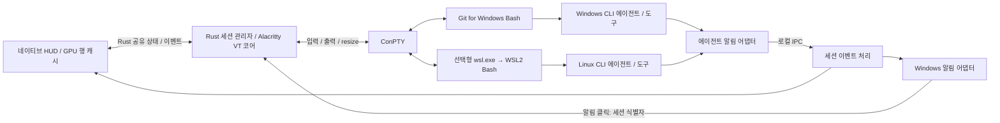

# MiniTerm 구현·스펙·배포 계획

작성/수정: 2026-10-10 · 상태: P0 구현 진행 · 주 대상: Windows 11 x64

**구현 방향 변경 (2026-10-10):** 사용자의 Warp 참고·성능 요구에 따라 초기 Tauri/WebView2/xterm.js 제안을 **Rust + egui/eframe + wgpu(DX12) + Alacritty VT 코어 + ConPTY**로 변경했다. 기술 선택과 측정 방법은 [PERFORMANCE.md](PERFORMANCE.md), 실제 검증 상태는 [IMPLEMENTATION.md](IMPLEMENTATION.md)를 확인한다. 제품 동작·Bash 기본 프로필·세션 수명·알림 의미·성능 목표는 유지한다. WebView2 및 Node는 현재 앱의 실행/빌드 의존성이 아니다.

Windows 환경에서 이어서 개발할 때는 [WINDOWS_HANDOFF.md](WINDOWS_HANDOFF.md)의 셸 선택·저장 위치·준비 절차·성능 검증 기준을 함께 읽는다. 기존 PowerShell 기본 셸 제안은 아래 Bash 계획으로 대체한다.

## 1. 제품 방향

작업표시줄 바로 위에 작은 터미널 HUD를 상시 표시한다. 한 번 클릭하면 즉시 현재 터미널에 입력하고, HUD 헤더를 더블 클릭하면 아래쪽 기준점을 유지한 채 위로 길게 확장한다. 다른 앱에서 작업하는 동안에도 셸과 CLI 에이전트는 계속 실행되며, 에이전트가 응답을 마치면 HUD 상태와 Windows 알림으로 알려준다.

권장 구성은 **독립 HUD + 시스템 트레이 + 선택형 전역 단축키**다. 작업표시줄 내부에 텍스트 입력창을 삽입하는 기능은 첫 버전 범위에서 제외한다. Microsoft의 기존 IDeskBand 문서는 신규 개발에 다른 방식을 권고한다. 이를 근거로 Explorer 확장에 의존하지 않는 독립 창을 선택한다. 이는 구현 권고이며, Windows 작업표시줄 확장의 모든 가능성을 검증했다는 의미는 아니다. [Microsoft IDeskBand](https://learn.microsoft.com/en-us/windows/win32/api/shobjidl_core/nn-shobjidl_core-ideskband)

첫 버전의 에이전트 알림 대상은 Codex와 Claude Code로 가정한다. 다른 에이전트도 일반 터미널 명령으로 실행할 수 있지만, 정확한 응답 완료 알림은 전용 어댑터를 구현한 제품에 제공한다.

제품의 대화형 셸은 **Bash**로 선택한다. Windows C:/D: 프로젝트를 주 대상으로 가정하여 **Git for Windows의 Bash를 기본 실행 환경**으로 검증하고, WSL2 Bash는 Linux 프로젝트용 선택 프로필로 제공한다. PowerShell/cmd를 사용자 셸이나 자동 대체 셸로 제공하지 않는다. Bash 구문은 기존 Bash 실행 파일에서 처리하며 자체적인 셸 해석기를 만들지 않는다.

WSL2를 사용한다고 `/mnt/c`에서 작업해야 하는 것은 아니다. Windows 도구는 Windows 파일시스템, Linux 도구는 WSL의 Linux 파일시스템에서 작업하도록 설계한다. `/mnt/c`의 프로젝트에 Linux 도구를 사용하는 조합은 기본 경로에서 피한다. [Microsoft 파일 저장 권고](https://learn.microsoft.com/en-us/windows/wsl/filesystems)

## 2. Starboard에서 참고할 부분

로컬 `starboard/`는 macOS용 Swift/AppKit/SwiftTerm 프로젝트이며, 확인 기준 커밋은 `179d3a0`이다. MiniTerm의 Windows 구현은 루트의 `src/`에서 별도로 개발한다.

| 참고 요소 | 확인한 구현 | MiniTerm 적용 |
| --- | --- | --- |
| 작은 상주 터미널 | 테두리 없는 NSPanel, Dock 주변 배치 | 작업표시줄 위 독립 HUD |
| 지속되는 셸 | LocalProcessTerminalView에서 로그인 셸 실행 | 세션별 지속되는 ConPTY + Bash, 선택형 WSL2 Bash |
| 확장과 축소 | 같은 패널과 터미널의 크기 변경 | 같은 세션을 유지하며 위쪽으로 확장 |
| 다른 작업과 병행 | 비활성 패널, Dock 위치 추적 | 대기 중 포커스를 빼앗지 않고 명시적 클릭 때 활성화 |
| 화면 변경 대응 | Dock 상태 및 모니터 추적, 고정 위치 대체 | 모니터 작업 영역 및 DPI 기반 배치 |

실제 로컬 확장 구현은 작업 영역 너비·높이의 75%를 차지하는 중앙 배치다. 사용자 요청에 맞춰 MiniTerm에서는 하단에 고정한 채 위로 확장하는 동작으로 변경한다. macOS의 모든 Space/전체화면 표시 동작을 Windows에서 동일하게 제공한다고 가정하지 않는다.

참고 코드: [PanelBuilder.swift](../starboard/Sources/Starboard/PanelBuilder.swift), [AppDelegate.swift](../starboard/Sources/Starboard/AppDelegate.swift), [DockGeometry.swift](../starboard/Sources/Starboard/AppDelegate+DockGeometry.swift), [공개 저장소](https://github.com/palamim/starboard).

Starboard의 MIT 라이선스를 확인했다. 코드를 가져오는 경우 원 저작권·라이선스 고지를 배포물에 포함한다. Windows 창 처리와 터미널 호스트는 별도로 구현한다.

## 3. 사용자 동작

| 상황/입력 | 동작 |
| --- | --- |
| 시작/로그인 후 실행 | 이전 위치에 미니 HUD 표시. 현재 앱의 입력 포커스 유지 |
| HUD 또는 터미널 한 번 클릭 | 현재 세션의 터미널 입력으로 즉시 포커스 이동 |
| HUD 헤더/상태 영역 더블 클릭 | 확장과 축소 전환. 첫 클릭의 포커스 이동을 지연시키지 않음 |
| 터미널 본문 더블 클릭 | 미니에서는 확장. 확장 상태에서는 기본 확장/축소, 설정에서 단어 선택으로 변경. Shift를 누르면 터미널 선택 |
| 확장 후 다른 앱 클릭 | 기본값은 미니 HUD로 복귀. 창 설정에서 자동 축소를 끄면 확장 유지 |
| 헤더/가장자리 드래그 | 위치 이동/마우스 크기 조절. 위치와 크기 저장 |
| 트레이 아이콘 클릭 | HUD 표시 및 포커스 이동. 트레이 메뉴에서 숨기기/설정/종료 |
| 전역 단축키 | 현재 세션 표시 및 포커스 이동. 초기 제안 Ctrl+Alt+Space, 충돌 시 변경 |
| 응답 완료 알림 클릭 | 해당 세션 선택, HUD 확장, 터미널 포커스 이동 |
| HUD 숨기기 | 셸과 에이전트 계속 실행 |
| 앱 종료 | 셸도 종료. 실행 중인 세션이 있으면 종료 동작에서 안내 |

터미널의 Esc, Ctrl+C, Tab, 방향키는 실행 중인 프로그램에 전달한다. Esc를 전역적인 HUD 축소 키로 가로채지 않는다. 축소 버튼과 HUD 헤더로 창 크기를 제어한다.

클릭하면 입력 대상은 **현재 터미널의 전경 프로그램**이다. 에이전트가 실행 중이라면 입력은 해당 에이전트로 전달된다. 동시에 일반 셸 명령을 실행하려면 새 세션을 만든다.

## 4. 구현 범위

### v0.1 MVP

- Windows 11 x64 독립 HUD, 트레이, 전역 단축키, 로그인 시 실행 설정.
- 한 번 클릭 입력, 더블 클릭 확장, 축소, 숨기기, 자동 축소 선택, 헤더 이동·가장자리 크기 조절.
- 지속되는 실제 터미널: 입력, ANSI 색상, 스크롤백, 선택·복사·붙여넣기, 터미널 크기 변경, Ctrl+C.
- 기본 셸은 Git for Windows의 `bash.exe --login -i`. 설치 위치 자동 탐색과 직접 지정 기능 제공. 미설치 시 Bash 설치 안내를 표시.
- 기본 프로필에서 Windows 프로젝트와 Windows용 개발 도구·CLI 에이전트를 사용. WSL 설치 없이 동작해야 함.
- 선택형 WSL2 Bash 프로필, 설치된 배포판 선택 및 알림 연결. Linux 프로젝트의 기본 시작 위치는 `/home` 아래이며 WSL 설치 자체는 사용자 환경에 맡김.
- 기본 세션 1개와 최대 4개의 독립 세션. 탭 또는 간단한 목록으로 선택하며 분할 화면은 제공하지 않는다.
- Codex 및 Claude Code 응답 완료 알림, 해당 세션으로 복귀, 알림 중복 방지.
- 지원되는 에이전트 이벤트에 한해 승인/입력 필요 상태 표시. 권한 승인은 터미널에서 처리한다.
- 모니터 선택, DPI 변경, 화면 연결 해제, 작업표시줄 자동 숨김 환경 대응.
- 기본 다크/라이트 테마, 글꼴·크기, 위치·크기, 알림·소리 설정 저장.

### 후속 버전

- Windows ARM64, macOS/Linux 플랫폼 대응.
- Gemini CLI/OpenCode 등 추가 에이전트 알림 어댑터.
- Zsh 및 일반 MSYS2 프로필, 더 많은 테마, 프로젝트별 프로필, 분할 화면.
- 외부 터미널 에이전트의 선택적 알림 연결 및 창 이동.
- 모든 가상 데스크톱 표시, 더 정교한 작업표시줄 위치 추적, 선택형 AppBar 모드.
- Portable ZIP 및 기업용 MSI/MSIX/Store 배포 검토.

### 첫 버전에서 제공하지 않는 기능

작업표시줄 내부 입력 UI, Explorer 패치, 기존 Windows Terminal 창의 임베딩, 임의 외부 에이전트 자동 감시, HUD에서 권한 요청 승인, AI 모델/API 직접 제공, 앱 종료 후 실행 프로세스 복원은 범위에 포함하지 않는다. 첫 버전은 Bash에 집중하며, Zsh 및 모든 Linux 바이너리의 Windows 직접 실행은 지원 범위에 포함하지 않는다.

실행 중인 세션은 HUD 크기 변경·숨기기에서 유지된다. 앱 재시작 시에는 셸 프로필과 시작 경로를 다시 열 수 있지만, 이전 프로세스의 메모리·환경·실행 상태까지 복원하지 않는다.

## 5. 화면 및 호환성 스펙

| 항목 | 초기 제안 |
| --- | --- |
| 운영체제 | 배포 시 지원 중인 Windows 11 안정판 x64. 실제 검증 OS 빌드를 릴리스에 기록 |
| 미니 HUD | 기본 560 × 112 DIP, 우측 하단, 작업표시줄/작업 영역 경계에서 8 DIP 간격 |
| 미니 화면 구성 | 입력 중심: 커서 줄과 최근 출력. 요약: 보고된 계획의 완료 항목 비율·현재 태스크 우선, 제목은 상단·AI Battery는 하단. 직접 보고가 없으면 명시된 화면 계획/실행 상태를 사용. 실제 VT 크기와 alternate screen 유지 |
| 확장 HUD | 미니와 같은 폭. 기본 작업 영역 높이의 70%, 이후 마우스로 조절한 높이 사용. 작은 작업 영역에 맞춰 제한 |
| 확장 방향 | 폭·하단·오른쪽 기준점을 유지하며 위로 확장 |
| 애니메이션 | 180ms. 확장 시작 시 최종 PTY 크기를 먼저 요청하고 커서 주변 화면을 이어서 표시. 동작 줄이기 설정 존중 |
| 셸 | Git for Windows Bash 기본, WSL2 Bash 선택형. PowerShell/cmd 자동 대체 없음 |
| 셸 실행 의존성 | 기본 프로필은 Git for Windows 필요. WSL2는 WSL 프로필에만 필요 |
| 프로젝트 저장 위치 | Windows 프로필: C:/D: 등 로컬 NTFS. WSL 프로필: 해당 배포판의 `/home` 아래 Linux 파일시스템 |
| 터미널 | UTF-8, ANSI/VT, alternate screen, 커서 제어, 한글 IME, 터미널 크기 변경 |
| 스크롤백 | 세션당 10,000행 기본값, 설정 가능 |
| 세션 | 기본 1개, 최대 4개. 각 세션에 셸·시작 경로·에이전트 연결 정보 보유 |
| 모니터 | 지정 모니터 우선. 분리되면 주 모니터로 복귀. 입력 중 자동으로 다른 화면에 이동하지 않음 |
| 창 표시 | 일반 앱 위에 표시. 대기·알림 시 비활성 상태 유지, 클릭/단축키/알림 클릭 때 활성화 |
| 전체화면/가상 데스크톱 | 현재 데스크톱 기준. 독점 전체화면·UAC 화면 위 표시와 모든 데스크톱 상주는 첫 버전 보장 범위에서 제외 |
| 저장 | 사용자별 로컬 설정. 터미널 출력·프롬프트 본문은 기본적으로 디스크에 저장하지 않음 |

작업표시줄의 높이를 상수로 가정하지 않는다. 모니터별 작업 영역을 우선 사용하고, 작업표시줄 정보를 읽을 수 없는 경우 지정 모니터의 안전한 하단 위치로 대체한다. 자동 숨김이 켜져 있어도 입력 중인 HUD가 갑자기 사라지지 않게 한다. MVP에서는 화면 작업 영역을 예약하지 않는다.

성능 수치는 출시 목표다. 동일한 Windows 테스트 장치에서 HUD 클릭 후 입력 가능까지 p95 100ms 이내, 로컬 입력 반영 p95 50ms 이내, 한 세션의 유휴 앱 CPU 평균 0.5% 이하 및 메모리 200MB 이하를 목표로 한다. 현재 네이티브 구현에는 WebView2 하위 프로세스가 없으며 GPU 메모리와 셸·에이전트 사용량은 별도로 측정한다.

위 입력 목표는 이미 실행 중인 세션 기준이다. Bash 최초 실행, WSL 최초 기동, 사용자 셸 초기화 파일의 비용은 별도로 측정한다. 기본 프로필은 WSL을 기동하지 않는다. WSL의 VM·Linux 프로세스 메모리도 별도 항목으로 기록하여 전체 시스템 비용을 확인한다.

## 6. 기술 구성

현재 스택은 **Rust + egui/eframe + wgpu(DX12) + Alacritty VT 코어 + Windows ConPTY**다. 창·프로세스·UI를 같은 Rust 앱에서 처리하며 브라우저와 JavaScript IPC 없이 GPU에 그린다. Warp의 Rust/GPU 구조와 보이는 내용만 렌더링하는 원칙을 참고하되 ANSI/VT 상태·스크롤백은 Alacritty 코어를 재사용한다. [Warp 구조](https://www.warp.dev/blog/how-warp-works), [egui](https://github.com/emilk/egui), [Alacritty 코어](https://github.com/alacritty/alacritty/tree/master/alacritty_terminal), [ConPTY 호스팅](https://learn.microsoft.com/en-us/windows/console/creating-a-pseudoconsole-session)

| 선택지 | 이 프로젝트에서의 판단 |
| --- | --- |
| Rust + egui/eframe + wgpu + Alacritty | 현재 구현. 네이티브 이벤트 루프, DX12 렌더링, Rust 내 VT 처리. 포커스·IME·TUI 실기 검증 필요 |
| Tauri + Rust + xterm.js | 초기 제안. 사용자 성능 요구에 따라 네이티브 GPU UI로 대체 |
| C# WPF + WebView2 + xterm.js | 초기 대안. 현재 네이티브 GPU UI 방향에서는 채택하지 않음 |
| Electron + node-pty + xterm.js | 개발 편의성이 장점. 상주 유틸리티의 배포 크기·메모리 목표를 검증하며 비교할 후보 |
| ANSI/VT 코어 직접 개발 | 선택하지 않음. ANSI/VT·스크롤백·선택·재배치는 Alacritty 코어를 사용하고 GPU 표시 계층만 구현 |

구성 요소별 책임:

- 창 제어: 미니/확장 상태, 크기, 모니터, 비활성 표시 및 명시적 활성화. winit/Win32로 구현.
- `SessionManager`: 세션 생성·선택·종료, 프로세스 수명, Bash 실행 환경·시작 경로. 창 크기 변경 시 셸을 다시 생성하지 않음.
- `ShellProvider`: Windows Bash와 WSL Bash의 실행 파일·인자·환경·경로 변환을 분리. 프로필 변경은 새 세션에서 적용하고 실행 중인 셸의 환경을 바꾸지 않음.
- `PtyBackend`: 입력·출력·행/열 변경. `portable-pty`의 Windows ConPTY 구현을 먼저 검증하고, 필요한 기능은 직접 Win32 API로 보완. [portable-pty Windows 코드](https://github.com/wezterm/wezterm/blob/main/pty/src/win/mod.rs)
- 터미널 표시: Alacritty VT 코어 + egui Painter + wgpu. 보이는 행만 캐시하고 alternate screen, 한글 IME 및 선택 동작 연결.
- `AgentAdapters`: 에이전트별 공식 이벤트를 공통 세션 이벤트로 변환.
- `NotificationBroker`: 중복 제거, HUD 배지, 소리, 알림 클릭에 따른 세션 선택.
- `SettingsStore`: 테마, 크기, 위치, 셸, 알림, 단축키. 설정 스키마 버전 포함.

PTY 읽기/쓰기는 UI 스레드를 막지 않는다. 출력을 배치해서 전달하고 큐의 크기를 제한한다. 출력이 많은 동안에도 입력과 크기 변경이 진행되어야 한다. ConPTY 문서는 통신 채널을 별도로 처리하여 교착을 피하도록 안내한다. [ConPTY 통신 안내](https://learn.microsoft.com/en-us/windows/console/creating-a-pseudoconsole-session)

터미널 UI는 네이티브 Rust 앱에 포함한다. 셸 실행은 구조화된 실행 파일·인자와 사용자 권한으로 처리하며 출력은 VT 코어로만 해석한다. OSC52 클립보드 읽기/쓰기는 기본 차단한다. 알림용 로컬 IPC는 현재 사용자만 접근하도록 한다.

### 6.1. Bash 선택과 파일시스템 성능

Git for Windows는 MSYS2 기반 패키지 구성으로 Bash와 Unix 계열 도구를 제공한다. 기본 프로필은 설치된 Git for Windows의 Bash를 재사용하고 Mintty나 Git Bash 별도 창을 띄우지 않는다. Bash 프로세스를 MiniTerm의 ConPTY에 직접 연결한다. [Git for Windows 기술 개요](https://gitforwindows.org/technical-overview.html), [MSYS2 터미널 연동](https://www.msys2.org/docs/terminals/)

| 사용 환경 | 파일 위치 | 실행 도구 | 계획 |
| --- | --- | --- | --- |
| Windows 프로젝트 | `C:\Projects\app` / Bash의 `/c/Projects/app` | Windows용 Git·Node·Rust·에이전트 | 기본 경로. 로컬 NTFS 사용 |
| Linux 프로젝트 | WSL의 `/home/<user>/projects/app` | Linux용 Git·Node·Rust·에이전트 | WSL Bash 선택 프로필 |
| Windows 프로젝트를 WSL에서 처리 | WSL의 `/mnt/c/Projects/app` | Linux 도구 | 사용자가 선택할 수 있으나 기본값으로 사용하지 않음 |
| Linux 프로젝트를 Windows 도구로 처리 | `\\wsl.localhost\...` | Windows 도구 | 빌드·검색·파일 감시의 기본 경로로 사용하지 않음 |

Windows Bash의 `/c/...`는 로컬 Windows 드라이브 경로의 표현이며 WSL의 `/mnt/c/...`와 실행 구조가 다르다. 다만 MSYS 런타임의 프로세스 생성·경로 변환 비용이 있으므로 모든 작업에서 더 빠르다고 단정하지 않는다. Linux 전용 도구와 Linux 파일시스템에서의 대량 작업은 WSL 프로필로 분리한다. Windows 도구 인자에 전달되는 경로는 MSYS의 변환 규칙을 검증한다. [MSYS2 경로 처리](https://www.msys2.org/docs/filesystem-paths/)

“완전한 Bash”의 목표는 기존 Bash의 구문·파이프·리다이렉션·변수·스크립트·히스토리·작업 제어를 올바르게 호스팅하는 것이다. Windows Bash가 Linux 커널, 모든 Linux 바이너리, 파일 권한·심볼릭 링크까지 동일하게 제공한다는 뜻은 아니다. 이러한 Linux 환경이 필요하면 WSL2 Bash를 사용한다. 기본 프로필의 TTY·Ctrl+C·작업 제어와 에이전트 TUI는 P0의 출시 조건이다.

성능 검증은 Windows Bash/NTFS, WSL Bash/Linux 파일시스템, WSL Bash/NTFS를 비교한다. 동일 도구 버전·데이터·장치에서 Git status, 파일 검색, 의존성 설치, 빌드, 파일 감시, 셸 시작 및 프로세스 생성 비용을 기록한다. 각 프로필에서 Windows Terminal을 같은 조건의 기준선으로 두어 셸/파일시스템 비용과 MiniTerm의 추가 비용을 구분한다. 상세 측정 방식과 통과 기준은 [Windows 인수인계 문서](WINDOWS_HANDOFF.md)에 정리한다.

## 7. CLI 에이전트 알림

### 완료의 의미

완료는 **에이전트가 한 요청에 대한 응답을 마침**을 뜻한다. 프로세스 종료, 모든 백그라운드 작업 종료, 테스트 통과 또는 요청한 작업의 성공을 뜻하지 않는다. 기본 알림 문구는 “Codex 응답 완료 · 프로젝트명”처럼 표시한다.

에이전트 출력이 잠시 멈춘 것, CPU 사용량, 프롬프트 모양만으로 완료를 확정하지 않는다. 일반 명령의 종료 알림은 별도 기능으로 취급한다.

| 에이전트 | 우선 연동 방식 | 제공할 상태와 제약 |
| --- | --- | --- |
| Codex | 공식 `notify`의 `agent-turn-complete` | 응답 완료. thread/turn ID로 세션 연결 및 중복 제거 |
| Codex 추가 상태 | 지원 버전의 UserPromptSubmit/PermissionRequest/Interrupt 훅 | 실행 시작·승인 필요·중단. 훅 검토/신뢰 절차와 버전 확인 필요 |
| Claude Code | UserPromptSubmit/Stop/Notification 및 지원 버전의 StopFailure 훅 | 실행 중·응답 종료·입력/승인 필요·API 오류. Stop 훅이 추가 작업을 유도하는 환경에서는 최종 종료와 구별 필요 |
| 기타 CLI | 어댑터 인터페이스, 후속 제품별 구현 | 첫 버전에서는 일반 실행만 지원. 완료 상태를 추정해서 확정 표시하지 않음 |

Codex의 `notify`는 JSON 인자로 이벤트를 전달하며 thread ID, turn ID, 작업 경로 등을 제공한다. 완료 알림에는 이 인터페이스를 우선 사용한다. [OpenAI Docs: Codex notifications](https://learn.chatgpt.com/docs/config-file/config-advanced#notifications)

Codex의 비관리 훅은 사용자가 정의를 검토하고 신뢰해야 실행된다. MiniTerm 설치만으로 훅이 활성화되었다고 표시하지 않고 연결 시험을 제공한다. [OpenAI Docs: Hooks](https://learn.chatgpt.com/docs/hooks)

Claude Code의 Stop은 응답 종료 이벤트이며 사용자 중단에서는 실행되지 않는다. 다른 Stop 훅, 백그라운드 작업, 하위 에이전트가 있는 경우에는 부모 응답 종료와 전체 작업 완료를 구분한다. 대응 필드가 제공되는 지원 버전에서 연속 실행을 확인하고, 확인할 수 없으면 “응답 종료 신호”로 표시한다. [Claude Code Hooks](https://code.claude.com/docs/en/hooks)

### 연결 및 이벤트 처리

MiniTerm에서 만든 셸에는 `MINITERM_SESSION_ID`를 전달한다. 기본 Windows Bash에서 실행되는 Windows 에이전트의 이벤트는 Windows 알림용 실행 파일을 통해 로컬 IPC로 전달한다. 선택형 WSL에서는 Windows 알림 실행 파일 호출 방식으로 연결하되, 환경 전달·설치 경로 변환·공백 경로를 P0에서 검증한다. Windows Bash와 WSL Bash는 각각 연결 상태를 표시한다. 에이전트 설정과 로그인 정보는 Windows/WSL 설치 환경별로 관리한다.

MiniTerm의 입력 셸이 Bash라는 사실과 외부 에이전트가 내부 도구 실행에 선택하는 셸은 별개다. Claude Code의 공식 Windows 설정은 Git Bash 경로 지정과 Bash 도구 사용을 지원한다. Codex를 포함한 에이전트의 내부 셸 선택은 지원 버전과 설정을 검증하고, MiniTerm이 임의로 PowerShell 명령을 Bash 명령으로 번역하지 않는다. [Claude Code Windows 설정](https://code.claude.com/docs/en/setup#install-on-native-windows)

기존 에이전트 설정을 보존하면서 MiniTerm 항목을 추가·제거할 수 있게 한다. 특히 Codex의 기존 `notify`가 있으면 이벤트를 함께 전달하는 구성을 제공하거나 충돌을 안내하고, 덮어쓰지 않는다. 에이전트 로그 파일의 내부 포맷을 주 연동 인터페이스로 삼지 않는다.

공통 이벤트는 앱 세션 ID, 에이전트 세션 ID, 가능한 turn/event ID, 발생 시간, 이벤트 종류, 작업 경로를 포함한다. 이벤트 종류는 실행 중/응답 종료/입력 필요/실패/중단/연결 불명이다. 공식 이벤트가 없는 상태를 임의로 채우지 않는다. Codex notify만 연결된 경우에는 완료 알림은 제공하지만 실시간 실행/승인 상태는 연결 불명으로 둘 수 있다.

식별자가 있는 이벤트는 이를 기준으로 중복 제거하고, 없는 경우에는 세션·이벤트·짧은 시간 구간을 이용한다. 하위 에이전트 종료를 부모의 완료 알림으로 처리하지 않는다. 공식 종료 신호를 받은 뒤 추가 실행 신호가 오면 배지를 다시 실행 중으로 전환한다.

### 표시와 복귀

- 백그라운드 세션: HUD 배지 + Windows 알림. 소리는 기본 꺼짐.
- 사용자가 보고 있는 세션: HUD 상태로 표시하고 같은 이벤트의 팝업을 생략.
- 알림 클릭: 대상 세션 선택 후 확장. 자동으로 명령을 실행하거나 Enter를 전달하지 않음.
- 대상 세션이 이미 종료된 경우: 세션 종료 안내. 이전 작업을 다시 실행하지 않음.
- 알림이 차단되거나 방해 금지가 켜진 경우: HUD 배지와 알림 목록 유지.
- 기본 알림 내용: 에이전트명·프로젝트명·상태. 프롬프트와 응답 본문 노출은 선택 설정.

**WindowsToastAdapter**에서 앱 식별자와 클릭 활성화를 직접 구현하고 설치본으로 검증한다. Rust WinRT/COM 경로를 우선 검증하며 별도 런타임이 필요한 대안은 이 검증 후 결정한다. [Windows 알림 활성화](https://learn.microsoft.com/en-us/windows/apps/develop/notifications/app-notifications/app-notifications-quickstart)

## 8. 배포 방식

| 단계 | 배포물 및 채널 | 동작 |
| --- | --- | --- |
| 개발/P0 | 로컬 개발 실행 + 시험용 NSIS 설치본 | 입력·터미널뿐 아니라 실제 설치본의 알림과 클릭 복귀 검증 |
| 비공개 알파 | GitHub Releases의 Windows x64 NSIS `.exe` | 사용자별 설치, 수동 업데이트, 버전별 변경 기록 |
| 공개 베타/v1 | Windows 코드 서명한 NSIS `.exe` | stable/beta 채널, 서명된 업데이트, 세션을 마친 뒤 적용 |
| 후속 | winget, ARM64, MSI/MSIX/Store, Portable ZIP | 메인 설치본 검증 후 채널별 요구 사항 확인 |

NSIS 사용자별 설치를 기본으로 하고 MiniTerm 본체 설치에 관리자 권한을 요구하지 않도록 한다. 네이티브 앱이므로 WebView2를 설치하지 않는다. Git for Windows Bash·CLI 에이전트는 기존 설치를 탐색하고 미설치 시 안내한다. WSL2는 선택 프로필의 의존성이며 기본 설치/실행 조건이 아니다. 첫 버전은 Bash 런타임 자체를 재배포하지 않는다.

업데이트 어댑터는 네이티브 앱 구조에 맞춰 M3에서 선정한다. 업데이트 검증용 서명 키와 Windows 실행 파일의 코드 서명은 별도 관리한다. 공개 배포용 코드 서명 수단과 비용은 배포 준비 단계에서 확정한다.

실행 중인 셸을 강제로 종료하는 자동 업데이트는 제공하지 않는다. 업데이트를 다운로드한 뒤 사용자가 세션을 마치고 재시작할 때 적용한다. 알파에서는 이전 설치본을 다시 설치하는 복구 절차를 준비하며, 자동 롤백은 첫 버전에서 제공하지 않는다.

설정과 로그는 사용자별 로컬 데이터 경로에 저장하고 버전이 바뀌어도 유지한다. 제거 시 MiniTerm이 추가한 시작 프로그램·알림 등록·에이전트 연동 항목을 정리한다. 기존 에이전트 설정은 보존한다. 배포물에는 라이선스 고지와 버전/빌드 정보, 체크섬을 포함한다.

Windows 러너에서 빌드·패키징하는 CI를 구성한다. Rust/의존성 버전을 잠그고 CI 서명 키를 소스에 넣지 않는다. 현재 앱 구현은 Windows 네이티브 도구와 Windows NTFS 작업 폴더에서 진행하며 포커스·IME·ConPTY·설치본 알림을 직접 검증한다. Linux 프로필 검증용 프로젝트는 WSL의 Linux 파일시스템에 별도로 둔다.

## 9. 작업 순서와 완료 기준

기간은 개발자 1명 기준 초기 추정이며, P0 결과에 따라 조정한다. 목표는 알파 3~4주, 공개 베타까지 총 4~6주다. 서명 수단 확보나 외부 배포 채널 심사 기간은 별도로 잡는다.

| 단계 | 예상 기간 | 구현/검증 결과 | 다음 단계로 넘어갈 기준 |
| --- | --- | --- | --- |
| P0 기술 검증 | 3~5일 | Windows Bash/ConPTY 1세션, 한글 입력, 확장, 에이전트 이벤트, 설치본 알림 클릭 복귀, 파일시스템별 성능 비교 | WSL 없이 기본 동작, Bash·TUI·작업 제어 정상, 첫 클릭 입력 손실 없음, 프로세스 유지, 알림 복귀, MiniTerm 추가 비용 목표 충족 |
| M1 터미널 MVP | 1~2주 | HUD/트레이/단축키, 최대 4세션, 프로필·설정, 모니터/DPI 대응 | 기존 셸 상태 유지, TUI/복사/붙여넣기 정상, 포커스 자동 탈취 없음 |
| M2 에이전트 연동 | 약 1주 | Codex/Claude Code 어댑터, 상태 배지, 중복 방지, 알림 설정 | 응답 종료·중단·승인 필요 구별, 잘못된 세션 이동 없음, 기존 설정 보존 |
| M3 배포/베타 | 약 1주 + 조정 여유 | 설치/제거/업데이트 CI, 코드 서명, 릴리스 안내 | 깨끗한 Windows 환경에서 설치·알림·업데이트·제거, 유휴 자원 목표 확인 |

P0에서 네이티브 UI의 포커스/IME 또는 Windows 알림 활성화가 핵심 요구를 만족하지 못하면 winit/Win32 입력 경로와 렌더링 통합을 먼저 점검한다. Windows Bash의 ConPTY·작업 제어·에이전트 호환성이 미달이면 다른 MSYS2 구성과 WSL 프로필을 비교하되 WSL을 필수로 바꾸기 전 파일 위치별 측정 결과를 문서화한다. 성능 문제를 해결한다는 이유로 사용자 프로젝트를 자동 복사·동기화하지 않는다.

필수 시나리오는 다음과 같다.

1. 편집기에서 글을 쓰는 동안 HUD 업데이트·에이전트 완료가 발생해도 입력 포커스가 이동하지 않는다.
2. HUD 한 번 클릭 직후 한글/영문 첫 입력이 누락되지 않고, 더블 클릭으로 확장해도 입력이 중복 전달되지 않는다.
3. `cd`, 환경 변수, 셸 기록과 실행 중인 에이전트를 유지하면서 확장/축소/숨기기를 반복한다.
4. Windows Bash와 선택형 WSL Bash에서 Codex/Claude Code 응답 완료 알림을 받고 해당 세션으로 복귀한다.
5. 두 에이전트의 동시 이벤트, 중복 이벤트, 사용자 중단, 오류, 승인 요청을 구분한다.
6. Claude Code의 추가 Stop 훅 및 백그라운드 작업에서 전체 작업 성공을 잘못 알리지 않는다.
7. 터미널의 Esc/Ctrl+C, 전체 화면 TUI, 출력 폭주, 한글 IME·붙여넣기, 프로필·시작 경로의 공백을 검증한다.
8. 서로 다른 DPI의 두 모니터, 음수 화면 좌표, 작업표시줄 자동 숨김, 모니터 분리에서도 HUD가 화면 밖에 남지 않는다.
9. 알림 차단, 대상 세션 종료, 앱 재시작 뒤 오래된 알림 클릭을 처리한다.
10. WSL이 없는 새 Windows 환경에서 Git for Windows Bash와 함께 설치·연동·설정 유지 업데이트·제거를 수행한다.
11. Bash의 파이프·리다이렉션·변수·스크립트·Tab·히스토리 및 Ctrl+Z/jobs/bg/fg와 Windows 에이전트의 Ctrl+C를 검증한다.
12. Windows Bash/NTFS, WSL Bash/Linux 파일시스템, WSL Bash/NTFS의 비용과 같은 환경의 Windows Terminal 기준선을 기록한다.

코드 테스트는 세션 수명, 이벤트 정규화·중복 제거, 창 좌표 계산처럼 의미 있는 로직에 집중한다. 창 포커스·IME·알림 활성화는 Windows 실행 검증으로 확인한다. 상세 꾸미기는 핵심 시나리오가 통과한 뒤 진행한다.

## 10. 현재 결정과 남은 선택

현재 제안은 Windows 11 x64, 작업표시줄 위 상주 HUD, 하단 기준 상향 확장, **Rust/egui/wgpu/Alacritty/ConPTY**, **Git for Windows Bash 기본 + WSL2 Bash 선택형**, Codex·Claude Code 알림, NSIS 사용자별 설치다. Windows 프로젝트의 기본 저장 위치는 로컬 NTFS이며 Linux 프로젝트는 WSL의 `/home` 아래에 둔다.

구현 전에 우선순위를 조정할 수 있는 항목은 주 사용 에이전트, 프로젝트가 저장된 파일시스템, 원하는 HUD 크기와 위치다. 본문 더블 클릭의 기본값은 텍스트 선택으로 두고 HUD 헤더에서 확장하도록 제안했다. Windows 실기 결과를 받아 최소 지원 빌드, Bash/에이전트 지원 버전, 알림 활성화 구현 및 성능 목표 달성 여부를 확정한다. [Windows 개발 인수인계](WINDOWS_HANDOFF.md)
